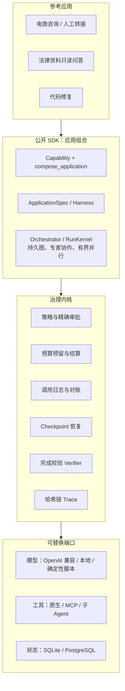

# ForgeHarness

[](https://github.com/l252916991-cyber/forgeharness/actions/workflows/ci.yml)


**让 Agent 安全执行写操作的治理运行时。**

模型可以决定「下一步做什么」，但「能不能做、做了几次、花了多少、事后能不能说清楚」不应该交给模型。ForgeHarness 把这些放进确定性的运行时：

- 每个写操作都要经过策略检查和精确审批；
- 进程崩溃后不会重复执行副作用；
- 结果不确定时先对账，不会盲目重发；
- 预算在调用前原子预留；
- 每一步的模型输入和工具副作用都能从哈希链 trace 中还原。

业务应用建立在这个治理内核之上，由「能力（Capability）」组合而成。同一套内核目前承载了三个参考应用：电商咨询与人工转接、法律资料只读问答、代码修复。

> 当前版本 0.13.0，未发布到 PyPI。业务数据全部是合成数据，没有真实用户或生产部署，详见[边界](#边界)。

## 解决什么问题

Agent 一旦能调用有副作用的工具（建工单、改文件、发消息），就会遇到普通 Demo 碰不到的问题：

| 问题 | 常见做法的风险 | ForgeHarness 的做法 |
| --- | --- | --- |
| 审批 | 只按工具名审批，批准后模型换了参数照样执行 | 审批绑定任务和规范化参数的 SHA-256 指纹，一次性、带过期，参数一变就失效 |
| 崩溃恢复 | 重启后从头再跑，副作用执行两次 | 执行前先持久化调用日志；恢复时已完成的复用结果，只有只读或幂等工具才重放，状态不确定的拒绝重放 |
| 结果丢失 | 超时当失败重试，或者当作没发生 | 标记为 unknown，保留预算预留，凭业务回执对账；查不到结果就停在待核对状态，绝不重发 |
| 成本失控 | 事后才统计 token | 步数、工具调用、token 硬预算；调用前预留、结算后释放，用量未知时继续保留预留，不当作零 |
| 多个 worker 抢同一任务 | 两个进程同时执行，结果互相覆盖 | 租约加单调递增 epoch，过期 worker 的写入在提交时被拒绝 |
| 事后追溯 | 日志里只有摘要 | 脱敏后的哈希链 JSONL trace，可篡改检测，可重建每次模型输入和工具副作用 |

## 架构



- **依赖单向**：应用依赖 SDK，SDK 依赖内核，内核不导入任何应用。`tests/unit/test_import_boundaries.py` 会强制检查这一点。
- **一律视为不可信**：模型输出、工具参数、MCP 返回、业务文档都要先校验，再进入执行。
- **完成要有证据**：模型声称完成时，由应用注入的 Verifier 检查工具结果。例如代码修复应用要求写入成功且之后测试通过；法律应用要求引用能落到原文页。
- **托管执行（可选）**：API 受理后返回 202 和 run_id，PostgreSQL 保存权威状态，独立 worker 竞争租约执行。控制面提供组织、工作空间和部署级授权；身份服务、Web、worker 分别使用三个最小权限数据库角色，并启用行级安全。

## 快速开始

需要 Python 3.12 和 [uv](https://docs.astral.sh/uv/)。下面的示例都不需要模型密钥、网络或 Docker。

```bash
git clone https://github.com/l252916991-cyber/forgeharness.git
cd forgeharness
uv sync --extra dev --extra cli --frozen
```

| 命令 | 演示内容 |
| --- | --- |
| `uv run --no-sync python examples/durable_demo.py` | 三个独立进程接力：第一个进程在写操作处挂起等待审批，第二个签发只对这个节点有效的审批，第三个恢复执行写入和测试；再次恢复时直接返回原结果，不重复执行 |
| `uv run --no-sync python examples/collaboration_demo.py` | 固定专家协作：一个专家的模型响应丢失后进入 `needs_reconciliation`，新进程凭回执对账后继续，不重发请求 |
| `uv run --no-sync python examples/parallel_demo.py` | 两个专家并发调用模型，其中一个响应丢失，由新进程凭回执恢复 |
| `uv run --no-sync python examples/fanout_demo.py` | 100 份材料拆成 4 组受治理的运行，程序合并答案；一组被服务商以 402 拒绝，作为失败组连同未检查的材料一起报告 |
| `uv run --no-sync python examples/sdk_demo.py` | 电商和代码两个应用跑在同一个 Harness 上 |
| `uv run --no-sync python examples/business_modules_demo.py` | 法律与电商共用的资料版本、独立审核和工作流模块 |
| `uv run --no-sync forge eval-control` | 无密钥控制评测（7 项） |

自己写一个工具、接入审批、跑代码修复应用，见 [Quickstart](docs/QUICKSTART.md) 和 [SDK 使用说明](docs/SDK_GUIDE.md)。

## 验证证据

- **测试与覆盖率**：0.13.0 冻结候选在源码和干净副本上各跑 2050 项核心测试，另有真实 PostgreSQL 状态与执行测试 227 项；综合覆盖率 91.8%，纯分支覆盖率 85.3%。详见[控制面报告](reports/saas/20261101-control-plane/REPORT.md)。
- **真实进程故障注入**：业务写入之后，分别用 SIGSTOP/SIGCONT 和 SIGKILL 打断 worker。新 worker 接管后 epoch 从 2 升到 3；旧 worker 恢复后不会重复产生业务效果或费用，由独立 oracle 核对每个副作用只发生一次。
- **缺陷是审计查出来的**：冻结候选后，在真实 PostgreSQL 中复现了一个并发缺陷：等待 run 锁之后，查询可能读到旧 checkpoint，从而接受过期的审批指纹。另一个是浏览器禁用 JavaScript 时，登录表单会把凭据放进 URL。两个都已修复并补了回归测试。这一轮共 4 个候选，前 3 个分别因为并发缺陷、测试脚本错误和安全审查未通过被拒绝，记录都保留着。
- **真实模型评测与改进**：接入 DeepSeek（`deepseek-flash`）跑基线，按失败 trace 分类后做了改进。在每个请求里写明「一步只能调一个工具」之后，ReAct 在 dev 集从 24/36 提升到 29/36，在改进前后各只跑一次的 holdout 集从 10/14 提升到 12/14；消融实验确认提升几乎全部来自这一项。之后又补上「临时故障可重试」的错误类别，dev 达到 30/36。Plan-Execute 没有变化。过程中还修了两个缺陷：评测报告会写入 API key，macOS 上文件工具全部失败。详见[实测报告](reports/deepseek-flash/REPORT.md)。
- **多 Agent 协作对照实验**：用同一个 DeepSeek 模型，在 4 到 32 份独立材料的审计任务上，比较 ReAct、「读完后一次调用」和固定专家协作。方案在 dev 集调通后封存，正式集 96 次运行只跑了一次。按事先写定的判定规则，协作在所有规模都不值得：「读完后一次调用」每个规模都是 8/8，约 1 秒，成本最低；协作在 32 份材料时降到 1/8，错误全部出在专家层，合并环节没有出错。详见[实验报告](reports/collaboration-scaling/REPORT.md)。之后在 12 道新题上做了消融：按封存的规则，没有一个变体被判为消除了失败。系统消息挪到最前面反而更差；要求专家先写结论再写总结，漏报从 4 个降到 0 个，但这个差异不显著。报告里也写明了判定规则本身的疏漏，见[消融报告](reports/collaboration-ablation/REPORT.md)。
- **协作「应该赢」的场景**：把材料加到 1024 份（约 42 万 token），比较一次调用、程序拆分和专家协作。一次调用在 512 份时错误率升到 3.4%，1024 份时升到 4.9%；两种拆分都把错误率压到 0.2–0.3%。但程序拆分和专家协作的准确率没有明显差别，而专家协作的成本是程序拆分的 3.1 倍、延迟是 28 倍。第一次正式集因为账户余额用完而作废，报告里如实保留了记录。详见[长上下文实验报告](reports/long-context-scaling/REPORT.md)。
- **本地模型对照**：更早在本地 9B 模型上比较 ReAct 和 Plan-Execute，两者成功率相同（19/34），但 Plan-Execute 多用约 27% 的 input token，详见[实测报告](docs/archive/M8B_LIVE_COMPARISON.md)。
- **CI**：每次推送都跑 lint、类型检查、全量测试、评测门禁和依赖漏洞审计，并冻结当前源码，在干净副本上完整复验一遍。

## 代码结构

| 目录 | 职责 |
| --- | --- |
| `src/forgeharness/runtime` | ReAct / Plan-Execute 循环、预算、重试、完成校验、子 Agent |
| `src/forgeharness/state` | 审批账本、调用日志、checkpoint、持久编排状态 |
| `src/forgeharness/tools` | 工具注册、参数校验、参数级策略、调度、MCP 适配 |
| `src/forgeharness/context` | 按 token 预算组装上下文、压缩、溢出落盘与回读 |
| `src/forgeharness/observability` | 哈希链 trace、脱敏、步骤投影 |
| `src/forgeharness/sdk` | 公开契约：ApplicationSpec、Capability、Harness、Orchestrator、协作、会话、工作流 |
| `src/forgeharness/cloud` | PostgreSQL 托管执行、租约与 epoch、身份与控制面 API、worker |
| `src/forgeharness/applications` | 电商、法律参考应用 |
| `src/forgeharness/coding` | 代码修复参考应用 |
| `tests/` `evals/` `benchmarks/` | 单元与集成测试、评测集、验证与故障演练脚本 |

## 边界

这个项目不声称：

- **真实业务可用**：所有业务数据都是合成的，没有真实用户、真实模型质量验收或生产部署。
- **已经是生产系统**：SDK 默认状态是单机 SQLite 加文件锁。PostgreSQL 托管执行的 worker 一次只处理一个任务；多 worker 公平调度、生产身份（OIDC/MFA）、计费都还没有实现。
- **外部 exactly-once**：本地 epoch 拦不住已经发出的请求，所以真正防重复要依赖下游的幂等键和回执查询；查不到结果时只能停下等人工核对。
- **操作系统级沙箱**：路径限制不等于沙箱。执行命令可以选用容器后端（无网络、只读根目录、非 root 用户）。
- **比其他框架更好**：与 LangChain/LangGraph 等框架的组合实验没有证明本项目的内核更优。

## 文档

| 文档 | 内容 |
| --- | --- |
| [Quickstart](docs/QUICKSTART.md) | 十行代码跑通一次受治理的运行，添加工具，写操作审批 |
| [SDK 使用说明](docs/SDK_GUIDE.md) | 接入步骤、能力组合、编排扩展点 |
| [架构](docs/ARCHITECTURE.md) | 模块边界、状态机、信任边界、依赖方向 |
| [当前能力矩阵](docs/CURRENT_CAPABILITIES.md) | 每项能力的实现位置、验证证据和未证明的范围 |
| [评测方法](docs/EVALUATION.md) | 指标、数据集划分、结论的使用规则 |
| [专题说明](docs/guides/) | 调用日志、持久编排、专家协作、并行、会话、托管执行、控制面等 |
| [架构决策记录](docs/adr/) | 40 多份 ADR，记录每个关键设计的取舍 |
| [文档导航](docs/README.md) | 全部文档的分类索引，包括已归档的阶段计划 |

## License

MIT。参考过的规范和研究见 [REFERENCES](docs/REFERENCES.md)；运行时没有复制上游 Agent 框架的实现。
