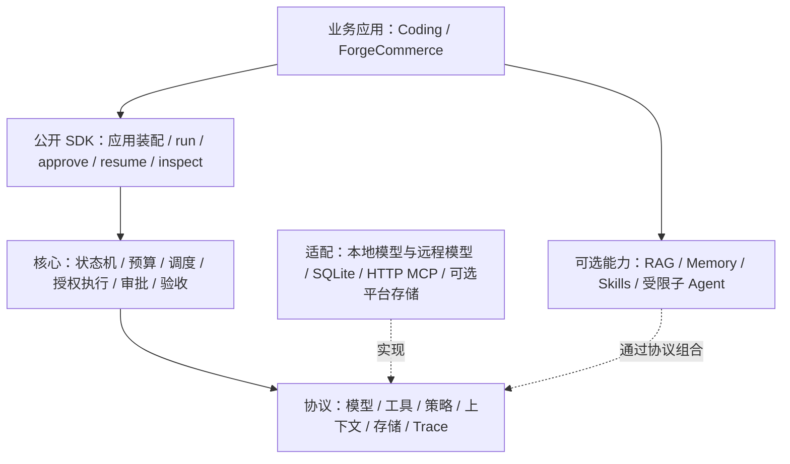

# ForgeHarness 通用 Agent 执行框架建设计划书

编制日期：2026-10-06  
状态：保留的 2026-10-06 规划基线；F0–F6 的 0.2.0 实现见 [FRAMEWORK_DELIVERY](FRAMEWORK_DELIVERY.md)，
2026-10-12 的 0.3.0 公共业务模块见 [BUSINESS_MODULES](BUSINESS_MODULES.md)。下文“当前/目标”指原规划时点。  
配套应用：[电商 Agent 平台计划书](ECOMMERCE_AGENT_PLATFORM_PLAN.md)

## 1. 项目目标

将 ForgeHarness 提炼为可嵌入 Python 应用的 Agent 执行框架。业务开发者提供模型、工具、权限策略、上下文来源和完成条件，即可复用受控执行、预算、审批、持久状态、恢复、Trace 与评测能力。

核心框架解决跨业务共性问题：模型输出如何进入确定的执行流程；工具何时允许调用；副作用和审批如何记录；中断后依据什么继续或停止；最终结果由什么证据支持。Coding、研发知识助手、电商咨询是框架的使用者。

本轮采用模块化单体、单仓库开发和本地单进程恢复模型。先稳定边界与公开接口，再根据发行需求拆包；首版不要求微服务、流程画布、插件市场或分布式 Agent 调度。

最关键的验收标准：**Coding 与电商应用都通过公开接口接入；新增电商能力不需要在核心运行时增加商品、订单或客服专属分支。**

## 2. 当前代码基础与需要改变的地方

以下为源码只读核对结果，未重新执行测试或模型评测。历史报告需要重新绑定到最终候选，不能直接视为当前目录已经通过验证。

| 项目 | 当前依据 | 框架化处理 |
| --- | --- | --- |
| 运行时依赖注入 | `runtime/loop.py` 已接收模型、Registry、Dispatcher、Policy、Trace、预算和持久组件 | 保留，建立统一应用装配入口 |
| 模型协议 | `models/base.py` 的 `Model`、`ModelRequest` 与协议错误 | 稳定为公共契约，移出对知识应用类型的反向依赖 |
| 工具与副作用类型 | `tools/base.py` 已有 Schema、超时、EffectClass、调用 ID、幂等键 | 增加可信身份/资源上下文与业务回执契约 |
| 权限策略 | `ToolPolicy.evaluate` 只有 task/spec/call 等输入 | 引入可信执行上下文，支持资源级判断 |
| 工作区前提 | `AgentRuntime.run`、`ToolContext`、验收请求要求 `workspace: Path` | 用资源 Scope 表达执行边界；文件工具仍必须获得合法工作区 |
| 业务验收 | 通用 `Verifier` 与 `CodingVerifier` 同在 `runtime/verification.py` | 将编码验收移到 Coding 应用，核心只保留契约 |
| 状态与恢复 | Checkpoint、Invocation Journal、RecoveryCoordinator 已存在 | 完善安全可继续路径，保留未知副作用的保守停止 |
| 审批 | 只有 `InMemoryApprovalLedger`；API 依赖进程内活动对象 | 持久化审批与任务绑定，支持重启后重建 |
| 知识能力 | `knowledge/protocols.py` 已有检索、Embedding、重排和存储协议 | 提炼可选知识扩展；商品等业务规则不进入该扩展 |
| 产品装配 | `api.py`、`knowledge/application.py` 直接组装具体应用 | 分离嵌入式 SDK、可选控制服务和业务路由 |
| 依赖与发行 | 主依赖包含 FastAPI、PDF、图片等能力 | 核心安装按需精简，Web/RAG/平台适配可选 |

先处理两项证据问题：当前目录无法读取 Git 元数据，应确认来源并建立可追溯版本；`STATUS.md` 中存在已完成与未完成的旧表述冲突，应按源码、测试和版本对应关系整理。历史文档中的不足也可能已经修复，必须逐项复核。

## 3. 分层与依赖方向



业务工具、策略、验收器通过注册和依赖注入装配。核心可以调用这些对象的协议方法，但不能导入业务模块。嵌入式应用可直接运行框架；FastAPI 控制服务只是另一种入口。

建议目录为逐步迁移目标：

```text
src/forgeharness/
  sdk/                  # 稳定公开入口、装配、配置校验
  domain/               # 状态、消息、上下文、证据等公共类型
  runtime/              # 循环、预算、重试、通用验收调用
  tools/                # Registry、Dispatcher、策略与工具协议
  context/              # 预算编译、来源、压缩
  state/                # 持久状态协议、恢复决策
  observability/        # 事件、Trace、投影
  adapters/             # 模型、存储、传输的具体实现
  extensions/           # 可选知识、记忆、Skills、协作能力
  applications/coding/  # 当前 Coding 参考应用
apps/forgecommerce/     # 电商应用自己的领域、工具、策略和 API
examples/               # 最小装配、扩展工具、审批恢复
```

这是依赖边界目标，不要求一次性搬动全部文件。先补兼容导出和行为基线，按模块迁移；应用最终只依赖公开 SDK 和已声明的扩展接口。Python 包内的私有文件、数据库表或事件细节不能成为业务应用的隐式 API。

## 4. 八组公共契约

下面的 C1–C8 是两份计划共用的编号。已有协议优先扩展，不为改名重写实现。

### C1：应用定义与可信执行上下文

目标对象：`ApplicationSpec`、`RunContext`、`ResourceScope`。

- 应用定义包含应用 ID/版本、工具集合、模型配置引用、预算、策略、上下文提供者、验收器以及必要扩展。
- 执行上下文包含 run/session/application ID、由服务端认证产生的 actor、tenant/store 范围、授权资源、策略版本和关联 ID。
- Coding 采用规范化的工作区 Scope；电商采用店铺及业务资源 Scope。工作区不再是所有任务的必填项，但文件工具缺少工作区时必须拒绝执行。
- 用户消息、模型参数和普通配置文本不能覆盖身份、角色、店铺归属或执行预算。
- 首版应用使用明确注册的 Python 实现；配置只选择已注册能力，不从任意类路径动态导入代码。安装的扩展代码属于可信计算范围，不声称能沙箱执行恶意插件。

验收：纯只读电商查询无需伪建 Git 目录；Coding 越界防护不退化；跨应用/店铺资源和伪造身份被拒绝。

### C2：模型接入

沿用 `Model`、`ModelRequest`、`ModelResult`；统一能力声明、结构化动作、用量、错误和取消语义。通用模型能力类型从业务知识类型中提取。

验收：确定性模型及现有真实模型适配器可切换；非法动作不派发工具；错误请求仍按明确口径记录已消耗资源。Embedding、Reranker 等能力通过可选扩展使用，不强迫所有应用安装。

### C3：工具调用与业务回执

沿用 `Tool`、`ToolSpec`、`ToolContext`、`ToolOutput`，保留 Schema 校验、输出限制、超时和副作用声明。

应用提供工具实现及业务参数；框架注入可信 Scope、logical_call_id、attempt_id 和幂等键。业务结果通过结构化回执表达资源 ID、状态、版本和证据引用；核心不解释订单字段。

调用成功只表示工具执行结果可用，不自动等于业务目标完成。长时操作可返回“已受理”的 job_id，再用状态查询工具推进；不能因为任务进入队列就报告完成。

验收：默认副作用分类保持保守；声明幂等的工具确实消费稳定键；重复请求、超时、格式异常和“已受理但未完成”均有契约用例。

### C4：授权、风险策略与人工审批

扩展 `ToolPolicy`，在规范化参数、可信身份、Scope 和当前资源状态下返回 allow / deny / require approval。框架确保每次执行都经过策略；具体订单归属、内容发布角色等规则由业务层实现，并在业务 API 内再次校验。

持久审批绑定任务、动作、参数指纹、授权者身份、资源版本/必要前置条件、有效期和策略版本。恢复后重新检查当前权限与业务状态；审批时看到的内容改变，原批准不能自动沿用。

`granted_by` 等客户端文本不能充当已认证身份。框架不内置完整身份系统，宿主应用负责认证，框架只接受可信装配产生的身份上下文。

验收：参数替换、跨店铺、过期、撤权、版本冲突、并发批准和重复消费都有明确拒绝结果；审批在重启后可恢复；批准记录和实际执行一一关联。

### C5：状态、调用日志与恢复

沿用 `CheckpointStore`、`InvocationJournal`、`ApprovalLedger` 等边界：checkpoint 管执行控制状态，journal 管调用副作用事实，业务账本管真实业务结果，Trace 提供证据。

| 已知状态 | 原则 |
| --- | --- |
| completed 且有有效结果 | 复用结果并重建模型可见 observation，不能再次执行副作用 |
| 尚未开始或只读调用 | 在权限、预算、状态版本均满足时按支持的恢复规则继续 |
| 已开始且业务支持稳定幂等键 | 先核对结果或使用同一键执行受支持的重试，不能更换键制造第二个动作 |
| 非幂等调用的结果不明 | 保持不确定状态并停止自动重放，由业务核对或人工处理 |
| 等待审批 | 重建待审批动作，检查批准的有效性及当前权限 |

先支持一个明确的持久存储配置，例如同一 SQLite 数据库中的审批与调用记录；审批消费和执行资格的原子关系需要 ADR 与故障注入证明。其他存储适配不得自动继承同样的事务保证。

框架调用去重不等于业务请求去重：用户重试可能创建新的 run，业务仍需 request_id / 业务操作键和唯一约束。外部副作用不承诺通用 exactly-once；soft deadline 仍属于停止接收后续步骤的时间控制，不取消已开始的写入。

### C6：上下文与可选知识能力

提炼 `ContextProvider`，输出含来源、版本、授权范围、有效期和内容类型的上下文材料；编译器统一应用预算、优先级和溢出策略。Prompt、工具说明、Skills 与检索片段均属于需版本化的模型输入。

复用现有 FTS5/向量/RRF/重排、文档解析和审核记忆，作为可选知识扩展。业务权限过滤必须发生在检索与读取时；不能先取回其他店铺资料，再让模型“自觉忽略”。模型可见说明、检索文档、MCP 响应不构成授权。

验收：上下文来源可定位；引用指向原资料；会话隔离、撤销记忆、资料更新、缺证据拒答和注入内容均有测试。商品价格、库存、订单状态从实时业务接口获取，知识扩展只为说明、政策与内容资料提供证据。

### C7：业务完成验收

保留通用 `Verifier`，由应用实现 CodingVerifier、商品咨询验收、工单创建验收等。它们检查完整、带时序和版本的结构化证据，核心只执行验收决策。

验收：测试之后再次写文件不能复用旧测试声明完成；模型说“已创建工单”但没有有效回执不能成功；排队中的视频任务不能当作已产出文件；重启后验收证据仍可查询。验收器只证明其明确检查的属性，不是通用正确性证明。

### C8：运行证据与评测

稳定 run/step/logical_call/attempt ID 与事件版本，复用哈希链 Trace、步级投影、Bad Case 和 Recorded Replay。运行查询接口统一，业务证据通过类型与引用扩展。

明确隐私与复现边界：可在模型调用前脱敏的数据，应保存实际发送的脱敏输入；确有授权使用的敏感输入保存在受控证据存储，普通 Trace 留引用、摘要和访问范围。仅有哈希无法重建输入；用于导出的删减版报告要标记不可完整回放。凭据不进入模型输入或普通 Trace。

身份权限、保留期限、脱敏与删除规则同时覆盖 checkpoint、journal、Trace、附件和评测导出，避免其他持久副本残留。删除恢复所需证据后，相应任务应禁止继续恢复，并明确标记无法完整回放；凭据只通过服务端受控引用取用，不写入这些持久记录。

验收：同一工具/预算/审批事件格式服务两个应用；哈希链可检测链内不一致。若要承诺检测截尾或整体替换，必须另有可信保存的最终摘要与事件数作对照；只有文件内部哈希链时不作该保证。回放验证运行时行为，真实模型重新运行才用于判断 Prompt 或策略效果。

## 5. 应用开发者的接入流程

公开 SDK 的期望使用流程如下，这是接口设计示意，不是当前可运行 API：

```text
1. 注册业务工具、策略、上下文提供者与验收器。
2. 构造 ApplicationSpec，选择已安装的模型/存储适配器。
3. 宿主应用完成认证并创建可信 RunContext。
4. 提交任务，获得 run_id；查询状态与证据。
5. 若需要审批，由具备权限的用户批准具体动作。
6. 运行结束后取回业务结果；异常时依据状态核对或恢复。
```

配置中的预算、工具集合和数据访问范围由宿主部署者设定。业务用户可以在权限内提出任务，不能通过任务文本扩大权限。

首版提供嵌入式 SDK、一个可选 HTTP 控制服务和 CLI 示例。控制接口负责运行、审批、恢复与证据查询；商品、订单、知识运营等 API 由电商应用拥有。控制服务仍需宿主认证，不能因其“通用”而开放全部 run 数据。

## 6. 模块迁移与发行策略

| 当前模块 | 迁移目标 |
| --- | --- |
| `runtime/`、`domain/`、通用工具与状态协议 | 保留为核心，抽离具体业务分支 |
| `runtime/verification.py::CodingVerifier`、`coding/` | Coding 参考应用，通过公开 SDK 接入 |
| `context/repository.py` | Coding 专属上下文能力；核心保留编译协议 |
| `models/`、SQLite/HTTP 等实现 | 适配层，修复对知识应用类型的依赖 |
| `knowledge/` | 拆分可选检索/存储协议与具体研发知识应用装配 |
| `api.py`、`web.py`、`cli.py` | 通用控制与具体应用入口分离，提供迁移说明 |
| `langchain_impl/` | 可选对照实现；不接管核心控制状态 |

初期仍可发行一个 wheel，配以清晰的可选依赖和公开模块边界；后续拆包由实际消费者需求决定。核心安装不应强制启动 FastAPI、OMLX、Redis、Qdrant 或下载模型。具体 extra 名称在 F5 冻结，计划中不把尚未实现的安装命令当作现成功能。

版本规则：公开 API、工具 Schema、事件、checkpoint、业务证据分别版本化；旧 checkpoint 无迁移方案时必须明确拒绝，不能静默按新语义继续执行。已有 CLI 优先保留兼容入口，弃用项需给出替代方式和时间范围。

## 7. 框架里程碑

| 阶段 | 工作与交付 | 依赖 | 建议工时 | 验收 |
| --- | --- | --- | --- | --- |
| **F0 基线与边界** | 能力矩阵、源码身份、依赖图、范围/授权/恢复/公开 API 的拟议 ADR | 无 | 8–12h | 文档与代码状态一致；历史报告适用范围明确；阻断项有清单 |
| **F1 可嵌入核心** | 抽离 Coding 验收、消除反向依赖、最小装配接口、精简核心安装 | F0 | 18–24h | 无 Web/知识平台依赖也能跑 keyless 最小应用；业务不能被核心导入 |
| **F2 可信上下文与审批** | C1/C3/C4、资源 Scope、身份策略、持久审批及应用重建 | F1 | 24–32h | 工作区与业务资源各有约束；过期/篡改/跨店铺/并发审批拒绝正确 |
| **F3 恢复与证据** | C5/C6/C7/C8、恢复矩阵、上下文与证据持久化、版本语义 | F2 | 24–36h | 核心故障窗口被覆盖；不确定副作用不会被自动重放；验收证据可恢复 |
| **F4 两应用验证** | Coding 迁移；对接电商 E1；修正暴露出的共性契约问题 | F1–F3、E0/E1 | 14–20h | 两应用只用公开接口；电商不需要核心专属分支；保留原能力回归证据 |
| **F5 SDK 交付** | 装配/工具/策略/验收教程、配置说明、类型支持、版本兼容、构建安装验证 | F4 | 12–16h | 新环境从构建产物安装并运行两种最小示例；无需修改 sys.path 或复制源码 |
| **F6 框架发布审计** | 冻结源码、质量/依赖/安全/架构/声明审计，修复与干净环境复验 | F5 | 12–20h | blocker/high 关闭；剩余风险与适用部署范围公开；证据绑定同一候选 |

框架工作量约 112–160 小时。F4 仅计算框架适配、Coding 迁移和接入验证；电商工具、数据和界面开发在电商计划计时，避免重复预算。

F4 与 E1 联合推进：E1 先使用 F1 的协议草案实现业务工具，待 F2/F3 可用后完成真实接入；F4 验收后冻结首个共同契约版本。F6 只要求最小电商参考应用，不要求全部后续运营模块完成，避免循环依赖。

## 8. 框架验证体系

测试跟随行为变化和缺陷修复新增，优先覆盖边界与可观察结果，而非复制实现分支。

1. **依赖边界**：核心不得导入 Coding/ForgeCommerce；应用只使用允许的公开接口。构建后在独立目录导入运行，避免源码路径掩盖缺依赖。
2. **契约测试**：所有模型、工具、策略、持久组件和验收器实现遵循同一套输入/输出与失败语义。
3. **故障注入**：审批消费、调用 started、业务副作用、journal 保存、checkpoint 保存各窗口；验证业务账本和运行时状态，不能只断言 Trace 文本。
4. **跨应用隔离**：相同工具名、run ID 外部输入、跨 Scope 资源、提示注入、MCP 恶意结果不能扩大权限或读到另一应用记录。
5. **业务完成证据**：完成状态对应正确版本的测试、引用、工单或任务回执；拒绝空泛的成功声明。
6. **策略评测**：保留确定性控制集与真实模型集的区分；旧 holdout 分析后作为历史/回归证据，新的泛化主张使用全新留出集。

硬门禁目标：全部冻结控制与兼容用例通过，纯分支覆盖遵循现有 85% 门槛，安全边界失败和重复副作用为发布阻断。真实模型成功率与成本如实报告；框架的正确执行不能用模型表现替代。

框架基准至少记录 C1–C8 版本、应用版本、模型与参数、源码身份、数据 hash、预算和副作用适配能力。核心效果、模型质量、应用业务质量分别报告。不会因为增加多 Agent 就宣称更好。

## 9. 两个项目的联合执行路线

建议每周投入 20–25 小时，按约 16 周组织完整路线；工时估算为框架 112–160h、电商 100–150h，合计 212–310h，加约 20% 缓冲约 254–372h。每周 25h 对应约 11–15 周，每周 20h 对应约 13–19 周；样本标注、外部模型等待和生产渠道接入可能延长。

| 时间窗口 | 框架工作 | 电商工作 |
| --- | --- | --- |
| 第 1–2 周 | F0、F1 | E0：业务数据、最小语料、模拟接口和标注草案 |
| 第 3–5 周 | F2、F3 | 按协议实现 E1 的只读咨询和转接工单工具 |
| 第 6–8 周 | F4、F5 | E1 联合验收；形成商品咨询最小演示，开始 E2 |
| 第 9–11 周 | F6 框架审计、修复与冻结 | E2 内容草稿/审核、E3 员工训练与视频处理的分阶段接入 |
| 第 12–14 周 | 维护兼容，必要变更通过版本升级 | E4：评测、反馈、候选版本比较与回滚 |
| 第 15–16 周 | 联合缺陷修复与重冻结 | E5：应用审计、最终演示和项目材料 |

这是工序建议，不是各阶段必须按周自动通过的承诺。第 6–8 周目标是一个可展示的候选组合，不能提前称为完整发布。视频处理、微调和多 Agent 扩展可以后移，核心审批、状态、权限和结果证据不能用删减门禁换进度。

框架的使用说明和接口草案先稳定，电商据此接入；应用反馈暴露的通用问题可以反向推动框架，但必须同时证明 Coding 场景仍成立。电商专属条件留在业务策略和验收器。

## 10. 发布、学习与项目展示

按照 AGENTS.md 冻结候选，审查架构、正确性、测试、安全、依赖、文档与简历声明；修复 blocker/high 并补回归；再从干净 checkout 等价环境执行全部适用门禁。新框架发布范围与旧增强版审计范围分别列明，不能凭新示例通过就关闭无关的历史开放项。

正式实施前将非平凡决策记入 `docs/adr/`，至少覆盖分层依赖、执行 Scope、审批/调用事务边界、事件与持久状态版本。将已验证能力同步到 `STATUS.md`；尚未实现的接口继续留在计划中。

最终项目展示可用两段：先演示同一套核心如何运行 Coding 与电商咨询，再选择审批恢复或故障回放做技术深挖。框架叙述强调公共契约、可靠性和复用；电商叙述强调业务数据、知识质量、运营流程和用户效果。个人实际完成的设计、实现、AI 辅助与验证范围均如实说明。

框架首版完成的标志是：**独立应用能通过文档接入、关键边界有证据、两个业务验证了抽象、构建产物能安装，且审计明确允许发布。**
