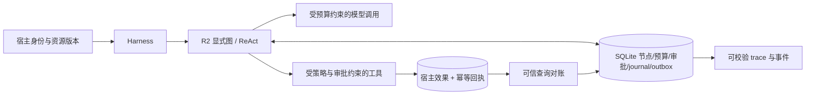
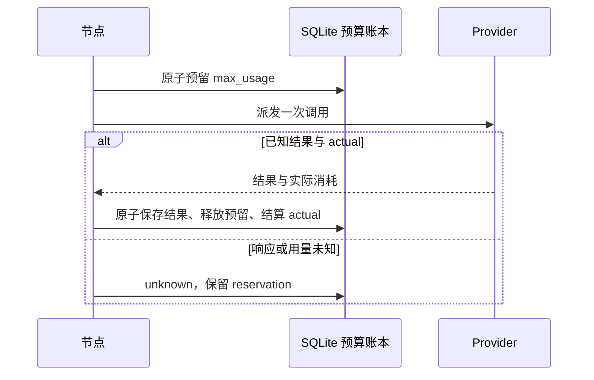
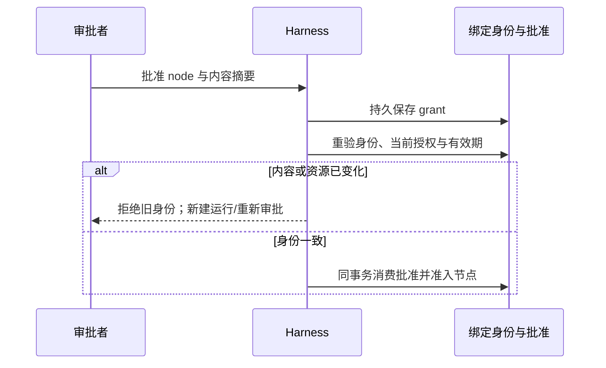
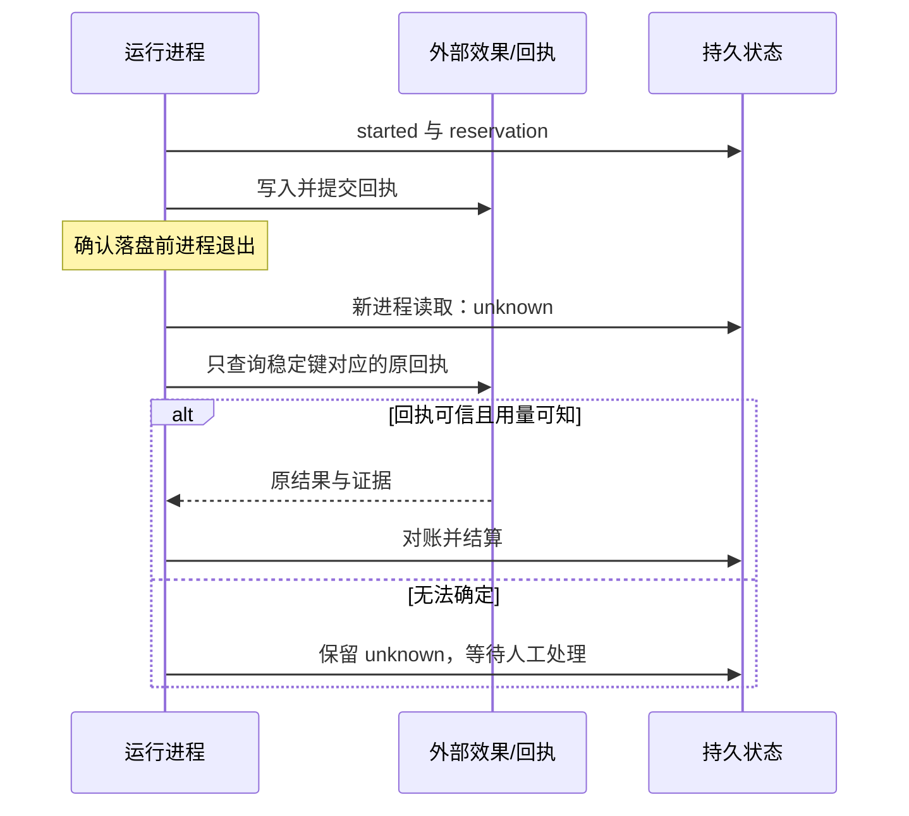
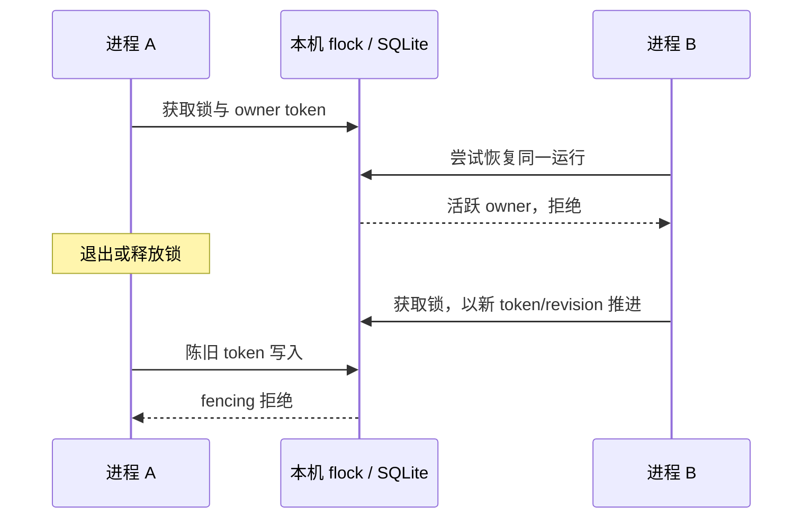

# 恢复演示与现场解释

2026-10-26。命令在源码检出中执行；它使用既有 R2 测试 fixture，合成外部系统是另一份
SQLite，不访问商家或案件数据库。

```bash
uv run --no-sync python -m benchmarks.improvement_demo --output reports/recovery-demo-new-attempt
```

输出目录必须是新目录。实际运行的四个独立进程分别为：工具已提交后退出、恢复发现 unknown、
从外部回执对账、再次恢复读取终态。输出 `external synthetic receipt count: 1`。
完整 trace、数据库、各阶段 JSON/日志均在目录中；保留无法证明的状态，不把模拟回执说成真实商家验收。

三分钟讲解安排：0:00–0:35 说明状态/预算/审批不能只在模型文本里；0:35–1:20 运行演示，
指出第一进程退出并不等于工具没执行；1:20–2:05 打开恢复日志和回执，说明为什么不能盲重试；
2:05–3:00 展示下图与边界，回答如何换成宿主幂等键和可信回执查询。



四个现场主题各绑定具体实现与失败例。下列提纲可用于学习，不能冒充本人已经完成无 AI 演练。

预算预留与结算：解释“预留是阻止其他节点超支的责任占位，已知 actual 才释放；unknown 不填零”。
实现 `sdk/durable.py` / `state/orchestration.py`；失败例为
`test_unknown_usage_is_not_released_to_an_independent_branch`，等于上限与超限见
`test_reservation_competition_exact_limit_and_overrun`。



审批版本绑定：说明批准的是确切内容/资源/预算身份，不是一张可授权任意未来文本的通行证。
实现 `sdk/durable.py` / `state/approval.py`；失败例为
`test_active_run_cannot_change_its_frozen_request`、`test_expired_and_revoked_approver_cannot_admit`。



副作用 unknown：解释“派发过 + 没收到确认”不能视为失败重试，回执不存在也不总能证明未执行。
实现 `sdk/durable.py` / `state/invocation_journal.py`；失败例为
`test_unknown_effect_never_replays_even_when_idempotent`；宿主版见本轮 commerce process drill。



owner fencing：解释“flock 防止本机同时推进，owner token/revision 防止陈旧写；活着的挂起
owner 不能被抢占，不是跨主机 lease”。实现 `state/orchestration.py`；失败例为
`test_two_process_resumers_cannot_both_advance`、`test_owner_fencing_and_terminal_immutability`。



个人现场练习记录（未完成）：日期、题目/缺陷、无 AI 排查过程、定位到的实现、最小复现、
修复与回归、本人复述。必须由本人实际完成后填入；自动化测试不能替代这项学习证据。

简历可用表述：设计并实现单机 Agent 运行时，提供持久状态、预算预留与结算、审批内容绑定、
未知副作用对账和 trace；在隔离合成环境及两个已绑定 SDK 的宿主入口演练恢复。
演练次数与通过数必须从本轮最终报告填写。真实模型策略结果、独立接入体验、原生框架优势、
真实商家/法律业务验收、分布式调度和外部 exactly-once 当前均不能添加为已完成成绩。
