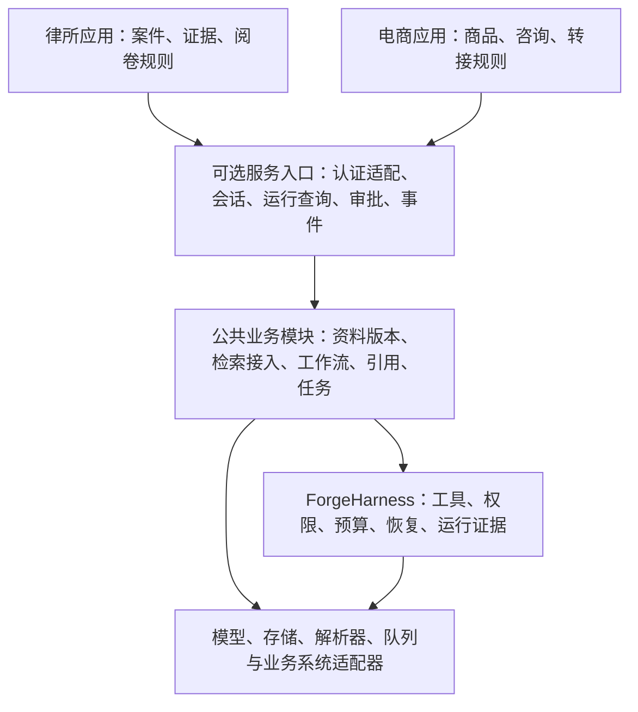

# ForgeHarness 下一阶段计划书

编制日期：2026-10-14  
基线：ForgeHarness 0.3.0，公共 SDK API v1。  
初始状态（2026-10-14）：完成计划审查，按第 5、6 节执行首轮 S0＋S1。
当前状态（2026-10-16）：S2–S5 的本地模拟候选已通过工程验收；真实业务接入、自然语言澄清/通用工单与独立专业终评仍未完成。详见 [执行状态](BUSINESS_EXECUTION_STATUS.md) 和 [候选审计](business-release-audit.json)。
本文件不表示下述功能已经开发或通过验收。首轮范围与补充契约见
[S0＋S1 范围与验收](../docs/archive/SESSION_PHASE_SCOPE.md) 和
[ADR 014](../docs/adr/014-durable-scoped-sessions.md)，实际放行以新候选审计为准。

## 1. 下一阶段目标

将已交付的嵌入式框架补成可承载日常业务应用的公共基础，再完成两条可运行的接入链路：

1. 律所：选择案件 → 读取授权资料 → 提问 → 查看原文引用 → 保存待审核笔记。
2. 电商：导入商品资料 → 审核知识 → 多轮咨询 → 查询当前价格库存 → 必要时转人工。

两种应用复用会话、任务、执行、审批和证据接口。案件规则、商品字段、订单规则以及业务验收留在各自应用内。是否提炼公共能力，以两个应用的契约用例为依据。

首个可用交付是共享应用基础与最小业务闭环；完整律所迁移、真实店铺上线、运营和培训是后续独立里程碑。

## 2. 已有基础与实际缺口

| 能力 | 当前状态 | 下一步 |
| --- | --- | --- |
| 应用装配、工具、预算、权限、审批、恢复、执行记录 | 公共 SDK 已有 | 接入服务和业务界面，补新入口的边界测试 |
| 工作流、资料版本、审核发布、来源依赖、引用校验 | 0.3.0 已有 | 两个应用直接复用，补领域适配 |
| 会话、历史、审核记忆 | 旧 knowledge 应用已有部分实现 | 提炼业务无关的契约，将历史与可信身份分开管理 |
| 解析、检索、上传、队列 | 旧可选模块已有部分实现 | 建立授权、版本、任务状态与 SDK 之间的统一接入方式 |
| API、轻量界面、状态查询 | 旧应用已有入口 | 建设可选的公共控制入口，业务页面按应用组织 |
| 法律、电商流程 | 合成资料与确定性参考流程已验证 | 接入宿主身份、受控资料与真实模型，分别验证业务质量 |
| 评测和故障回放 | 框架评测基础已有 | 新增业务数据、评分规则、失败案例与独立终评 |

0.3.0 的 654 项测试和审计只覆盖其已声明范围。旧平台中尚未关闭的审计问题需要逐项核实，不能因为新模块通过就自动关闭。

## 3. 分层与模块归属

该图是目标依赖关系。嵌入式消费者仍可直接使用 SDK，不要求启动 HTTP 服务。

| 公共部分负责 | 应用部分负责 |
| --- | --- |
| 会话隔离、历史预算、运行关联 | 哪些案件或商品允许进入当前会话 |
| 执行策略和审批机制 | 用户是否有案件、店铺及特定动作的权限 |
| 资料版本与审核生命周期 | 证据类别、商品属性、审核规则与来源许可 |
| 解析与检索协议、来源记录 | OCR、法条库、商品 API 等具体接入 |
| 任务进度、恢复与取消协议 | 任务能否重试、外部结果如何核对 |
| 通用验收调用和评测报告结构 | 法律引用适用性、商品事实、工单完整性等判定 |

实现优先复用现有代码。新增公共类型须经契约与 ADR 确定，本计划中的模块名称不是已经存在的 SDK API。公共 SDK 不导入业务应用；业务应用不直接读写框架内部数据库。

## 4. 分阶段实施

### S0：冻结下一阶段范围与验收样例

**工作**：核对可复用模块；确定两个应用的角色、资源和数据流；选定律所只读试点和电商 MVP；记录拟变更的持久状态、公开接口及迁移边界。

**交付**：需求到模块的映射表、接口草案、两条完整验收脚本、资料清单、相关 ADR。

**验收**：每个需求都有归属模块和可观察结果；已有能力不重复立项；确定性测试、模型质量评测和人工审核的职责分开。

### S1：共享会话与最小服务入口——第一优先级

**工作**：

- 会话与消息持久化，关联 application、tenant、actor、resource、run 和 workflow。
- 多轮历史按预算进入模型；保存实际使用的上下文和来源版本。
- 每次请求重新获得宿主认证身份和当前权限；用户文本不能覆盖租户、角色或范围。
- 提供会话、运行状态、审批、恢复和执行事件查询接口；界面只显示实际持久状态。
- 明确并发提交、重复消息、失败轮次、会话关闭及证据删除后的行为。
- 记忆先通过现有审核资料或明确审核入口接入，不让会话内容自动成为可信长期事实。

**交付**：会话公共契约、本地存储实现、可选 API 适配层、最小操作页面或客户端示例、两业务会话示例。

**验收**：重启后可继续会话；跨案件、跨商家读取被拒绝；撤权即时生效；会话并发不会串轮或重复写入；实际模型输入可追溯；旧 SDK 示例继续运行。

### S2：资料接入与后台任务

**工作**：

- 将已有上传、解析、检索组件接到版本化资料，形成“暂存 → 校验 → 审核 → 发布 → 可检索”的链路。
- 检索索引绑定资料版本。检索先限制授权候选范围，读取时再次检查权限及当前版本。
- 提供持久任务状态、进度、重启恢复和取消请求；先支持导入、解析、索引等明确任务。
- 定义取消语义：停止尚未开始的工作；已执行写入需核对结果，不能把取消描述为撤销或回滚。
- 按动作能力决定是否重试，稳定业务键跨尝试保持一致；结果不明的非幂等操作进入待核对状态。
- 明确临时文件、解析结果、索引、运行证据的保留和清理关系。

**交付**：公共导入接入协议、任务协议与本机实现、任务状态页、两个应用的导入适配示例。

**验收**：资料撤回后检索不能继续暴露旧内容；重试不重复创建资料；中途重启不虚报完成；取消、失败和待核对状态可区分；删除后的证据不能被用于恢复。

通用分布式调度和 outbox 不作为此阶段默认交付。未来接入真实外部写入时，按具体业务系统的事务和核对能力设计并验证。

### S3：律所只读试点与笔记流程

**工作**：以适配器连接 LexVault 现有案件身份、页级检索和引用结构；沿用其解析与法律业务能力；接通只读问答，再接入待审核笔记。先在 ForgeHarness 的合成夹具中验证，实际仓库迁移单独明确修改范围。

**交付**：法律适配器、案件问答与原文定位演示、待审笔记流程、与原有流程的同题对照报告、接入与回退说明。

**验收**：案件权限与原系统一致；页码、原文、版本能对应；缺证据时不虚构来源；资料变更使旧笔记失效；人工审核与工具执行审批分别可查；原系统仍可独立运行。

法律专业判断由领域规则、权威资料和具备相应能力的人员复核。精确引文通过不等于法律结论正确。此阶段不包含完整工作台迁移或代办真实法律事务。

### S4：电商咨询 MVP

**工作**：复用 S1/S2 和现有电商模块，建设商品导入、知识审核、多轮咨询、当前价格库存查询、人工转接及最小管理界面。

**首版数据**：一个演示商家、另一个隔离验证租户；30–50 个模拟商品及 SKU；20–30 份有来源的说明或 FAQ；模拟商品与工单 API。合成数据持续明确标注。

**交付**：咨询界面、资料审核界面、工单列表与详情、可复现演示数据和运行说明。

**验收**：

- 消费者可以追问、比较商品，答案关联当前可用资料。
- 价格和库存来自业务查询结果，带查询时点；不把静态文档当作实时库存。
- 无证据、业务冲突或要求人工时，按明确策略转接。
- 工单含必要上下文和证据；创建后的重试或恢复不产生重复工单。
- 只展示已验证结果；两个租户之间的数据和运行记录隔离。

运营文案、员工培训、视频处理在该 MVP 验收后分批加入。真实平台消息、支付、退款、改价和自动外发另行接入。

### S5：业务评测与候选发布

评测从 S0 开始准备，在本阶段完成冻结终评和发布审查。

**工作与交付**：

- 律所试点先整理 30–50 个开发案例，覆盖有据回答、无证据、来源冲突、跨案件和版本变更；专业质量终评另行封存、独立复核。
- 电商沿用已有规划：80 个开发案例、60 个全新封存终评案例，另建至少 40 个确定性权限、审批、注入和恢复案例。
- 按案件/商品族和来源分组切分；用于调试和选模型的数据不能继续作为未见终评。
- 分别报告事实正确性、引用正确性、澄清和转接表现、重复副作用、p50/p95 时延、token 与工具调用量。
- 真实模型评测记录模型、参数、预算、应用版本、资料版本和源码身份；重复采样与独立题目数量分别报告。
- 首次打开终评集之前冻结业务质量目标、评分规则和中止条件；法律判断需独立复核，不以模型自评代替。
- 执行候选冻结、源码审查、缺陷回归、完整门禁、干净环境复验和构建安装验证。

**验收**：所有冻结的确定性安全/兼容用例通过；确认的跨范围泄露、越权执行、重复副作用和虚假完成是阻断项；框架纯分支覆盖保持至少 85%；blocker/high 修复；达到预先冻结的业务门槛后才声明相应业务范围可交付。

若缺少可用模型、授权资料或专业评审，只能交付明确标注的模拟候选，不能将框架测试结果作为业务质量结果。

## 5. 顺序、工作量与阶段停止点

默认顺序：**S0 → S1 → S2 → S3 → S4 → S5**。业务资料和评测样例可提前准备；公共契约稳定后，两个应用的适配工作可以独立推进。

以下为基于当前代码的初步有效开发工时估算，包含实现、对应测试和文档，不含等待授权、人工标注和外部服务的时间；S0 完成后需重估。

| 阶段 | 初步工时 | 可以单独交付的结果 |
| --- | --- | --- |
| S0 范围与契约 | 4–8h | 可执行任务表和验收草案 |
| S1 会话与入口 | 28–40h | 有持久会话和可信身份的应用基础 |
| S2 资料与任务 | 24–36h | 可导入、审核、检索和观察任务进度 |
| S3 律所试点 | 16–24h | 一个可核对原文的案件问答与笔记流程 |
| S4 电商 MVP | 32–48h | 咨询、知识审核和人工转接闭环 |
| S5 评测与发布 | 20–32h | 有明确适用范围和证据的候选版本 |
| 合计 | 124–188h | 不含后续运营、培训及真实渠道 |

预留约 20% 修复缓冲后约 149–226h。按每周 20–25 个有效小时估算约 6–12 周；这不是固定交付日期。第一阶段可先以 S0+S1 为一个独立交付，避免必须等全部业务完成才获得可用成果。

## 6. 第一轮具体任务

1. 逐项核对现有会话、历史和上下文装配实现，列出可复用代码与应用耦合点。
2. 定义会话/消息/run/workflow 的关联、版本和并发规则，形成 ADR。
3. 定义服务端认证到 RunContext 的适配边界，以及每次操作重新检查权限的规则。
4. 实现会话创建、消息提交、历史查询和关闭，补持久化与并发测试。
5. 接入有预算的上下文提供者，记录实际模型输入与资料版本。
6. 通过现有 Harness/WorkflowRunner 接通运行状态、审批、恢复和事件查询。
7. 用一组案件会话、一组商家会话完成演示，验证重启、撤权和交叉访问。
8. 完成架构审查与兼容验证，冻结 S1 候选并从干净环境复验。

第一轮结束时，用户应能实际创建会话、连续提问、查看执行状态、完成所需审批，并在重启后继续未结束的工作。

## 7. MVP 后的扩展顺序

| 顺序 | 扩展 | 启动条件 |
| --- | --- | --- |
| 1 | 运营文案和脚本 | 商品咨询与知识版本稳定；复用草稿、审核和来源依赖 |
| 2 | 员工训练与质检 | 有许可明确且脱敏的案例、参考答案和人工复核机制 |
| 3 | 真实渠道与业务系统 | 明确平台、账号权限、接口约束、幂等能力与结果核对方式 |
| 4 | 图片与视频流程 | 文本流程已验证，任务预算、素材许可和产物验收明确 |
| 5 | 多 Agent、并行工作流或微调 | 单 Agent 基线和具体失败类型已确认，对照实验支持新增复杂度 |
| 6 | 分布式部署与高并发 | 实测负载超过单机目标，明确持久存储、租约和故障域需求 |

## 8. 依据与交付边界

- [0.3.0 模块说明](../docs/guides/BUSINESS_MODULES.md)
- [0.3.0 审计报告](modular-release-audit.json)
- [电商完整业务规划](../docs/archive/ECOMMERCE_AGENT_PLATFORM_PLAN.md)
- [历史框架演进规划](../docs/archive/FRAMEWORK_EVOLUTION_PLAN.md)

本计划从 0.3.0 的已验证状态继续，不重复执行已完成的框架首版建设。它是单独的规划产物，不更改冻结源码或沿用旧报告为未来版本背书。实施时对其他项目仓库的修改范围、真实业务接口和数据条件分别明确。
